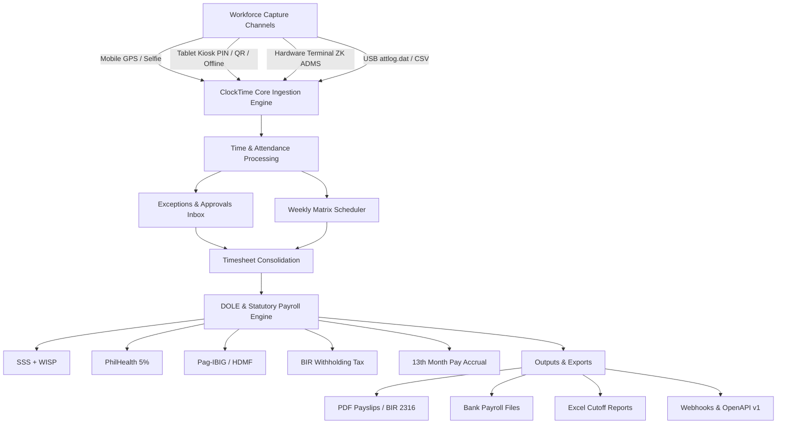
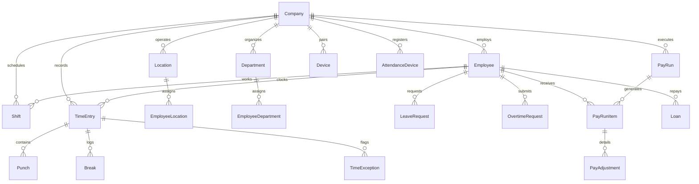

# ClockTime — Master Product Requirements Document (PRD) & Technical Specification

> **Version:** 1.0.0  
> **Classification:** Enterprise Product Specification & Architectural Blueprint  
> **Jurisdiction:** Philippines (DOLE, SSS, PhilHealth, Pag-IBIG, BIR TRAIN Law)  
> **Target Audience:** Engineering, Product, Architecture, HR Operations, Compliance Auditors  

---

## 1. Executive Summary & Product Vision

### 1.1 Product Identity
**ClockTime** is a cloud-native, multi-tenant enterprise Workforce Management (WFM), Time & Attendance (T&A), and Statutory Payroll automation platform designed specifically for Philippine businesses. It scales from single-branch SME retailers to nationwide logistics, retail chains, and 24/7 security agencies with hundreds of branches and thousands of field staff.

### 1.2 Core Problem Statement
Philippine enterprises face distinct workforce operational friction:
1. **Unreliable Punch Capture & Buddy Punching:** Field workers, branch attendants, and delivery drivers frequently operate outside headquarters, leading to falsified time cards and unverified overtime.
2. **Hardware Lock-in & Fragmented Biometrics:** Legacy ZKTeco standalone punch clocks require manual USB flash-drive collection (`attlog.dat`), lack centralized real-time sync, and do not connect to modern cloud HRIS systems.
3. **Complex DOLE Labor Multipliers:** Calculating Philippine premium pay manually (Night Differential from 10 PM to 6 AM, Rest Day 130%, Regular Holiday 200%, Double Holiday 300%, Rest Day Overtime 169%, and combinations thereof) results in payroll calculation errors, employee grievances, and DOLE audit penalties.
4. **Mandatory Government Remittances:** Monthly computation of SSS (including regular Social Security, Employee Compensation, and Mandatory Provident Fund/WISP), PhilHealth (5% premium split), Pag-IBIG (HDMF statutory caps), and BIR TRAIN Law graduated withholding tax brackets is labor-intensive and prone to compliance risks.

### 1.3 Strategic Solution
ClockTime resolves these challenges by unifying:
- **Universal Capture:** Geofenced mobile PWA punching, offline-capable shared tablet kiosks with PIN/QR badges, real-time ZKTeco ADMS cloud push server (`/iclock/cdata`), and USB log ingestion.
- **Automated Exception Engine:** Live detection of tardiness, undertime, missing punch-outs, overbreaks, and outside-geofence attempts.
- **Philippines Statutory Payroll Engine:** Deterministic calculation of DOLE wage premiums, statutory deductions, loan amortizations (SSS, Pag-IBIG, Calamity, Company loans), and automated 13th-month pay accruals with encrypted PDF payslip generation.
- **Clean Architecture & High Performance:** Sub-10ms query latency powered by Next.js 16 (App Router), Prisma 7, PostgreSQL (Singapore `ap-southeast-1`), Cloudflare R2 object storage, and Better Auth.

---

## 2. Product Requirements Document (PRD)



### 2.1 Persona Definitions & Access Roles

| Role | Target Persona | Scope of Authorization |
| :--- | :--- | :--- |
| **OWNER** | Business Owner / Founder | Unrestricted tenant control, billing management, company deletion, organization settings, role assignment. |
| **ADMIN** | Operations Director / VP HR | Full company oversight, branch configuration, statutory table overrides, audit log inspection, approval escalations. |
| **HR** | HR Manager / Payroll Specialist | Employee lifecycle, leave administration, payroll execution, statutory report generation, holiday configuration. |
| **SUPERVISOR** | Branch Manager / Shift Lead | Scoped to assigned locations/departments. Approves timesheets, shift swaps, overtime, and leave. Schedule creation. |
| **TIMEKEEPER** | Field Coordinator / Dispatcher | Read/edit access to punches and timesheets within assigned branches. Resolves punch exceptions. Cannot view base pay. |
| **EMPLOYEE** | Staff / Driver / Guard / Cashier | Scoped strictly to personal data (`/me`). Clock in/out, view schedule, request leave/OT/swaps, download payslips. |

---

### 2.2 Feature Specifications & Capabilities

#### Module 1: Universal Time & Attendance Capture
- **Mobile PWA Punching:**
  - GPS coordinate capture and distance calculation (Haversine formula) against branch geofence radius (meters).
  - Outside-geofence warning flag (`inOutsideGeofence`, `outOutsideGeofence`) without blocking emergency punches.
  - Front-camera photo proof upload to Cloudflare R2 object storage.
  - Offline punch queue stored in IndexedDB (`dexie.js`) with background sync when connectivity resumes.
- **Tablet Kiosks (Shared Wall/Counter Terminals):**
  - High-speed employee PIN entry or physical QR code badge scanner (`@zxing/browser`).
  - Offline punch buffer with local biometric/name caching.
  - Pairing code handshake with manager authorization.
- **Hardware Biometrics (ZKTeco ADMS Cloud Push Protocol):**
  - Native HTTP/HTTPS push listener at `/iclock/cdata` and command delivery at `/iclock/getrequest`.
  - Push protocol handling for attendance records, terminal heartbeat, and device status.
  - Zero-hardware simulation CLI (`pnpm adms:sim`) for end-to-end integration testing.
  - USB flash-drive backup ingestion (`attlog.dat` / CSV) for remote off-grid locations.

#### Module 2: Scheduling & Shift Planning
- **Weekly Matrix Scheduler:** Interactive grid supporting branch and department filtering.
- **Shift Lifecycle:** Draft -> Published -> Confirmed.
- **Midnight-Crossing Shifts:** Native support for 24/7 graveyard shifts (e.g., 22:00 to 06:00 next day) with cross-day holiday/night diff allocation.
- **Shift Swaps & Open Shifts:** Peer-to-peer swap requests with supervisor sign-off; unassigned shift broadcast and claiming.
- **Employee Availability:** Weekly recurring availability windows and ad-hoc blackouts.

#### Module 3: Approvals & Exception Management
- **Automated Exception Inbox:** Real-time detection of:
  - Tardiness / Late clock-ins (configurable grace periods, e.g., 5 or 15 mins).
  - Undertime / Early clock-outs.
  - Missing clock-outs (stale punches auto-closed after configurable threshold).
  - Unscheduled punches and unapproved overtime.
- **Multi-Level Approval Workflows:** Configurable approval chains (Direct Supervisor -> Branch Manager -> HR Department).
- **Audit Trails:** Immutable logging of every punch edit, override reason, and approval action with actor ID and IP address.

#### Module 4: Leave & Statutory Holiday Engine
- **Leave Entitlements:** Service Incentive Leave (SIL - 5 statutory days under DOLE), Vacation Leave (VL), Sick Leave (SL), Maternity Leave (105 days RA 11210), Paternity Leave (7 days RA 8187), Solo Parent Leave (7 days RA 8972), VAWC Leave (10 days RA 9262), Bereavement Leave.
- **Holiday System:** Nationwide Philippine holidays pre-seeded with support for regional and local holidays (e.g., Araw ng Maynila, Charter Day).
- **Holiday Classifications:** Regular Holidays, Special Non-Working Days, Special Working Days, and Double Holidays (two regular holidays on the same calendar day, such as Maundy Thursday / Araw ng Kagitingan coincidence).

#### Module 5: DOLE Statutory Payroll Engine
- **Gross Pay Engine:**
  - Base pay from hourly rates or monthly rate conversion factors (313 days, 365 days, 393.8 days).
  - Overtime multipliers based on Labor Code Article 87.
  - Night Shift Differential (NSD) 10% premium between 22:00 and 06:00.
  - Rest day, holiday, and special day multiplier combinations.
- **Statutory Deductions (Centavo Precision):**
  - **SSS 2025 Table:** Regular Social Security + EC (Employees' Compensation) + Mandatory Provident Fund (WISP) up to P35,000 MSC.
  - **PhilHealth 2025:** 5.0% premium rate, 50/50 employee/employer share, with statutory floor (P10,000) and ceiling (P100,000).
  - **Pag-IBIG 2024:** 2% employee, 2% employer contribution with P10,000 Maximum Fund Salary (P200 statutory cap each).
  - **BIR TRAIN Law Withholding Tax:** Daily, weekly, semi-monthly, and monthly graduated tax calculation.
- **Loans & Deductions:** SSS Salary Loan, SSS Calamity Loan, Pag-IBIG Multi-Purpose Loan, Pag-IBIG Housing Loan, Company Cash Advances.
- **13th Month Pay Tracker:** Continuous accrual formula: `(Total Basic Pay Earned) / 12`.
- **Outputs:** Bank-ready payroll files, comprehensive Excel cutoff sheets, and encrypted digital payslips with employee self-service access.

---

## 3. Philippine Statutory Compliance Reference

### 3.1 DOLE Wage Multiplier Matrix

$$\text{Hourly Gross Rate} = \frac{\text{Monthly Base Salary} \times 12}{\text{Applicable Working Days/Year} \times 8}$$

| Day Classification | Regular Hours (First 8h) | Overtime Rate (>8h) | Night Diff Regular (10PM-6AM) | Night Diff Overtime |
| :--- | :--- | :--- | :--- | :--- |
| **Ordinary Working Day** | 100% | 125% | 110% | 137.5% |
| **Scheduled Rest Day** | 130% | 169% | 143% | 185.9% |
| **Special Non-Working Holiday** | 130% | 169% | 143% | 185.9% |
| **Special Holiday on Rest Day** | 150% | 195% | 165% | 214.5% |
| **Regular Holiday** | 200% | 260% | 220% | 286.0% |
| **Regular Holiday on Rest Day** | 260% | 338% | 286% | 371.8% |
| **Double Regular Holiday** | 300% | 390% | 330% | 429.0% |
| **Double Holiday on Rest Day** | 390% | 507% | 429% | 557.7% |

### 3.2 Statutory Contribution Breakdown

#### SSS (Social Security System) — 2025 Schedule
- **Total Contribution Rate:** 15.0% of Monthly Salary Credit (MSC).
- **Employee Share:** 5.0% | **Employer Share:** 10.0%.
- **Minimum MSC:** P5,000 (Min Employee Share: P250.00).
- **Regular MSC Ceiling:** P20,000.
- **WISP (Workers' Investment and Savings Program):** MSC from P20,500 up to P35,000 allocated to WISP mandatory provident fund.
- **EC (Employees' Compensation):** P10.00 for MSC below P15,000; P30.00 for MSC P15,000 and above (100% employer-funded).

#### PhilHealth (Philippine Health Insurance Corporation) — 2025 Schedule
- **Premium Rate:** 5.0% of monthly basic salary.
- **Cost Sharing:** 50% Employee (2.5%), 50% Employer (2.5%).
- **Statutory Floor:** P10,000.00 (Minimum total contribution: P500.00 / P250.00 EE).
- **Statutory Ceiling:** P100,000.00 (Maximum total contribution: P5,000.00 / P2,500.00 EE).

#### Pag-IBIG / HDMF (Home Development Mutual Fund) — 2024 Schedule
- **Employee Share:** 1.0% (for monthly salary $\le$ P1,500); 2.0% (for monthly salary > P1,500).
- **Employer Share:** 2.0%.
- **Maximum Fund Salary (MFS):** Raised to P10,000.00.
- **Mandatory Maximum:** P200.00 Employee + P200.00 Employer = P400.00 total monthly cap.

#### BIR TRAIN Law Graduated Withholding Tax (Semi-Monthly Schedule)
1. **Bracket 1:** $\le$ P10,417 $\rightarrow$ P0.00
2. **Bracket 2:** P10,417 – P16,666 $\rightarrow$ 15% in excess over P10,417
3. **Bracket 3:** P16,667 – P33,332 $\rightarrow$ P937.50 + 20% in excess over P16,667
4. **Bracket 4:** P33,333 – P83,332 $\rightarrow$ P4,270.70 + 25% in excess over P33,333
5. **Bracket 5:** P83,333 – P333,332 $\rightarrow$ P16,770.70 + 30% in excess over P83,333
6. **Bracket 6:** > P333,332 $\rightarrow$ P91,770.70 + 35% in excess over P333,332

---

## 4. Technical Architecture & System Design

```mermaid
flowchart TD
    subgraph Client Layer
        Web["Desktop Web (Chrome / Safari / Edge)"]
        MobilePWA["Mobile PWA (iOS / Android)"]
        KioskApp["Kiosk Mode (iPad / Android Tablet)"]
        Hardware["ZKTeco ADMS Biometric Terminals"]
    end

    subgraph Edge & Routing Layer (Vercel)
        EdgeRouter["Vercel Edge Network / DNS"]
        AuthMiddleware["Better Auth Session Validation"]
        RateLimiter["Redis / Postgres In-Memory Rate Limiter"]
    end

    subgraph Application Core (Next.js 16 App Router)
        ServerActions["Server Actions & API Routes"]
        TenantContext["Tenant Context Provider (ctx.db)"]
        PayEngine["DOLE Payroll & Gross Calculation Engine"]
        ADMSListener["/iclock/cdata Push Listener"]
        ExportEngine["ExcelJS & React-PDF Workers"]
    end

    subgraph Persistence Layer
        DB[("Supabase PostgreSQL 16 (Singapore sin1)")]
        Pooler["PgBouncer Connection Pooler (Port 6543)"]
        R2["Cloudflare R2 Object Storage (Photos & PDFs)"]
        Resend["Resend Transactional Email Engine"]
    end

    ClientLayer --> EdgeRouter
    EdgeRouter --> AuthMiddleware --> ServerActions
    Hardware --> ADMSListener
    ServerActions --> TenantContext
    TenantContext --> Pooler --> DB
    PayEngine --> ExportEngine
    ExportEngine --> R2
    ServerActions --> Resend
```

### 4.1 Technology Stack Matrix

| Subsystem | Technology | Purpose & Implementation Details |
| :--- | :--- | :--- |
| **Framework** | Next.js 16.4.3 (App Router, Turbopack) | Server Components, Streaming SSR, Parallel Route Data Fetching |
| **Language** | TypeScript 5.8 | End-to-end type safety, strict null checking, shared validation schemas |
| **Database** | PostgreSQL 16 on Supabase | Hosted in Singapore (`ap-southeast-1`), sub-5ms roundtrip latency |
| **ORM** | Prisma 7.10.1 (`@prisma/adapter-pg`) | Client extensions for tenant isolation, type-safe migrations |
| **Connection Pooler** | PgBouncer (Port 6543, transaction mode) | Efficient connection reuse across serverless function instances |
| **Authentication** | Better Auth 1.7.14 | Session cookie management, TOTP 2FA, Magic Links, Passwords |
| **Object Storage** | Cloudflare R2 (`@aws-sdk/client-s3`) | S3-compatible zero-egress storage for punch photos & payslip PDFs |
| **Styling & UI** | Tailwind CSS v4 + Shadcn UI (New York) | Semantic design tokens (`border-border`, `bg-card`, `bg-primary`), `data-slot` |
| **Offline Storage** | IndexedDB via Dexie.js 4.4 | Client-side punch queuing and kiosk credentials offline buffer |
| **Biometrics** | ZKTeco ADMS Protocol | HTTP push ingestion handling `POST /iclock/cdata` |
| **Billing** | PayMongo API & Webhooks | GCash, Maya, GrabPay, Visa, Mastercard integration |
| **Email** | Resend API | DKIM/SPF verified transactional email dispatch (`onboarding@resend.dev`) |

---

### 4.2 Multi-Tenancy Architecture (`ctx.db`)
Multi-tenancy is enforced at the database query engine layer using Prisma Client Extensions (`src/server/tenant.ts`).
1. **No Raw Unscoped Queries:** Direct queries to tenant tables without `companyId` are blocked by TypeScript and runtime guards.
2. **Automatic Mutation Tagging:** Calling `ctx.db.shift.create({ data: { ... } })` automatically injects `companyId: ctx.companyId`.
3. **Query Interception:** `findMany`, `findFirst`, `update`, `delete`, `count`, and `aggregate` queries automatically append `where: { companyId: ctx.companyId }`.
4. **Super-Admin Bypass:** Global administrative functions under `/admin` execute via `db` (`prismaBase`), explicitly scoped to super-admin identity checks.

---

## 5. Technical Data Requirements List & Schema Dictionary

### 5.1 Core Entity Dictionary



#### Entity 1: `Company`
The root organizational tenant.
- `id`: String (UUIDv4), Primary Key
- `name`: String (e.g., "Apex Logistics Corp")
- `code`: String (Unique, 4-12 alphanumeric, e.g., "APEX2026")
- `timezone`: String (Default: "Asia/Manila")
- `payFrequency`: Enum (`WEEKLY`, `SEMI_MONTHLY`, `MONTHLY`)
- `subscriptionPlan`: Enum (`FREE`, `STARTER`, `PRO`, `ENTERPRISE`)
- `subscriptionStatus`: Enum (`TRIAL`, `ACTIVE`, `PAST_DUE`, `CANCELED`)
- `maxSeats`: Int (Nullable, null = unlimited)
- `maxLocations`: Int (Nullable, null = unlimited)

#### Entity 2: `Employee`
The central worker identity, linked optionally to a Better Auth `User` login.
- `id`: String (UUIDv4), Primary Key
- `companyId`: String (Indexed)
- `userId`: String (Nullable, unique within company; links to User)
- `employeeNo`: String (Unique within company, e.g., "EMP-00124")
- `firstName`: String, `lastName`: String, `middleName`: String?
- `role`: Enum (`OWNER`, `ADMIN`, `HR`, `SUPERVISOR`, `TIMEKEEPER`, `EMPLOYEE`)
- `hireDate`: DateTime
- `monthlyRate`: BigInt (Centavos, e.g., P25,000.00 = 2,500,000)
- `hourlyRate`: BigInt (Centavos)
- `dailyRate`: BigInt (Centavos)
- `sssNumber`: String?, `tin`: String?, `philHealthNumber`: String?, `pagIbigNumber`: String?
- `kioskPin`: String (Encrypted 4-6 digit string)
- `qrBadgeToken`: String (Unique random token for badge scanning)
- `rfidCardNumber`: String? (Unique for biometric terminal badge taps)
- `status`: Enum (`ACTIVE`, `INACTIVE`, `ON_LEAVE`, `TERMINATED`)

#### Entity 3: `TimeEntry` & `Punch`
Stores daily attendance records and punch pairs.
- `TimeEntry`:
  - `id`: String, Primary Key
  - `companyId`: String, `employeeId`: String, `locationId`: String?
  - `clockInAt`: DateTime, `clockOutAt`: DateTime?
  - `minutesRegular`: Int, `minutesOvertime`: Int, `minutesNightDiff`: Int
  - `dayType`: Enum (`ORDINARY`, `REST`, `SPECIAL`, `REGULAR`, `DOUBLE`, etc.)
  - `status`: Enum (`OPEN`, `PENDING_REVIEW`, `APPROVED`, `REJECTED`)
- `Punch`:
  - `id`: String, Primary Key
  - `timeEntryId`: String (FK)
  - `type`: Enum (`IN`, `OUT`, `BREAK_START`, `BREAK_END`)
  - `timestamp`: DateTime (UTC)
  - `source`: Enum (`MOBILE_WEB`, `KIOSK_PIN`, `KIOSK_QR`, `BIOMETRIC_ADMS`, `MANUAL`)
  - `latitude`: Float?, `longitude`: Float?, `accuracyMeters`: Float?
  - `photoUrl`: String? (Cloudflare R2 storage key)
  - `isOutsideGeofence`: Boolean

#### Entity 4: `AttendanceDevice` (Biometrics)
Manages cloud-connected ZKTeco ADMS hardware.
- `id`: String, Primary Key
- `companyId`: String (Indexed)
- `serialNumber`: String (Unique, e.g., "BKL921049281")
- `name`: String (e.g., "Warehouse B - Turnstile 1")
- `locationId`: String (FK)
- `ipAddress`: String?
- `lastHeartbeat`: DateTime?
- `firmwareVersion`: String?
- `pushProtocol`: String (e.g., "ADMS 2.4.1")
- `status`: Enum (`ONLINE`, `OFFLINE`, `UNCONFIGURED`)

#### Entity 5: `PayRun` & `PayRunItem`
Stores calculated payroll cutoffs and itemized payslips.
- `PayRun`:
  - `id`: String, Primary Key
  - `companyId`: String (Indexed)
  - `periodStart`: DateTime, `periodEnd`: DateTime
  - `payoutDate`: DateTime
  - `type`: Enum (`REGULAR`, `THIRTEENTH_MONTH`, `FINAL_PAY`, `SPECIAL`)
  - `status`: Enum (`DRAFT`, `CALCULATING`, `PENDING_APPROVAL`, `APPROVED`, `PAID`)
  - `totalGrossPay`: BigInt, `totalDeductions`: BigInt, `totalNetPay`: BigInt
- `PayRunItem`:
  - `id`: String, Primary Key
  - `payRunId`: String (FK), `employeeId`: String (FK)
  - `grossPay`: BigInt, `netPay`: BigInt
  - `basicPay`: BigInt, `overtimePay`: BigInt, `nightDiffPay`: BigInt, `holidayPay`: BigInt
  - `sssEe`: BigInt, `sssEr`: BigInt, `sssEc`: BigInt, `sssWispEe`: BigInt, `sssWispEr`: BigInt
  - `philHealthEe`: BigInt, `philHealthEr`: BigInt
  - `pagIbigEe`: BigInt, `pagIbigEr`: BigInt
  - `withholdingTax`: BigInt
  - `loanDeductions`: BigInt
  - `payslipKey`: String? (Encrypted PDF in R2 storage)

---

## 6. Developer APIs & External Integrations

### 6.1 REST API v1 Catalog (`/api/v1`)
All v1 endpoints authenticate via Bearer API Token (`Authorization: Bearer ct_live_...`) with rate limiting (1,000 req/min).

| Method | Endpoint | Description |
| :--- | :--- | :--- |
| `GET` | `/api/v1/openapi.json` | Complete OpenAPI 3.1 schema specification. |
| `GET` | `/api/v1/employees` | List active employees with pagination and location filters. |
| `POST` | `/api/v1/employees` | Create a new employee record and issue join code/PIN. |
| `GET` | `/api/v1/punches` | Query raw punch logs with date range and source parameters. |
| `POST` | `/api/v1/punches` | Ingest external attendance punches (e.g., third-party systems). |
| `GET` | `/api/v1/shifts` | Retrieve schedule matrix for assigned date ranges. |
| `POST` | `/api/v1/shifts` | Create or update work shift allocations. |
| `GET` | `/api/v1/pay-runs` | List payroll runs and execution statuses. |
| `GET` | `/api/v1/pay-runs/:id` | Retrieve comprehensive breakdown and payslip data for a cutoff. |
| `POST` | `/api/v1/attendance-logs` | Bulk upload raw biometric terminal punch records. |

### 6.2 ZKTeco ADMS Cloud Push Protocol
Hardware terminals communicate directly over standard HTTP/HTTPS:
1. **Device Handshake:**
   - `GET /iclock/cdata?SN=<SERIAL>` $\rightarrow$ Server responds `GET OPTION FROM: <SERIAL>\nStamp=<TIMESTAMP>`
2. **Punch Push Ingestion:**
   - `POST /iclock/cdata?SN=<SERIAL>&table=ATTLOG`
   - Body contains tab-delimited records: `<PIN>\t<TIMESTAMP>\t<STATUS>\t<VERIFY_TYPE>`
   - Server returns: `OK: <COUNT>`
3. **Device Heartbeat & Command Fetch:**
   - `GET /iclock/getrequest?SN=<SERIAL>` $\rightarrow$ Server dispatches pending commands (e.g., `CHECK`, `DATA USER PIN=...`).

### 6.3 Webhook Event Dispatcher
ClockTime issues cryptographically signed HMAC SHA-256 webhooks for enterprise events:
- Headers: `X-ClockTime-Signature: t=<TIMESTAMP>,v1=<HASH>`, `X-ClockTime-Event: <EVENT_TYPE>`
- Supported Events:
  - `punch.created`: Emitted when an employee clocks in or out.
  - `exception.detected`: Emitted on late arrival or geofence violation.
  - `leave.approved`: Emitted on leave sign-off.
  - `payroll.approved`: Emitted when a pay run is finalized.

---

## 7. Security, Compliance & Disaster Recovery

### 7.1 Data Privacy Act of 2012 (RA 10173) Compliance
- **PII Encryption at Rest:** Employee government IDs (TIN, SSS, PhilHealth, Pag-IBIG), bank account numbers, and salary rates are encrypted using AES-256-GCM (`DATA_ENCRYPTION_KEY`).
- **GPS Retention Automation:** Detailed latitude/longitude coordinates are purged after a configurable retention window (30 to 365 days; default 90 days), preserving branch and timestamp records for payroll auditing.
- **Biometric Privacy:** Facial punch verification images are stored in private Cloudflare R2 buckets with presigned time-limited access URLs (15-minute expiration). Fingerprint mathematical templates are kept on local hardware terminals and never stored in the cloud.

### 7.2 High Availability & Deployment Runbook
- **Database Resilience:** Hosted on Supabase (AWS Singapore Region `ap-southeast-1`), with automated daily snapshots, point-in-time recovery (PITR), and transaction-mode connection pooling (`PgBouncer`).
- **Edge Deployment:** Vercel Global Edge Network with Singapore `sin1` serverless function execution matching database geography (lowering latency from 70ms to 3ms).
- **Zero-Downtime Schema Migrations:** All schema updates follow forward-compatible database migration patterns (`prisma migrate deploy`), ensuring backward compatibility during rolling deployments.

---

*ClockTime Master Documentation — Maintained by the Core Engineering & Product Architecture Team.*
